# rEach and Teach: the system in figures

rEach is half of a system. It runs on the student's computer, inside their own AI agent; Teach is the course server the instructors run. These twelve figures show the two together: who is involved, what crosses between them, how a student gets in, what guards the agent, who may do what, what never leaves the student's computer, how a student reaches the instructors and what rEach keeps on the computer.

Teach is private. Every figure draws it as a frosted block and names only what it guarantees, never how it does it. Everything the figures say about Teach is already published in this repository, in [`README.md`](../README.md), [`PRIVACY.md`](../PRIVACY.md) and [`specs/wire.yml`](../specs/wire.yml).

Each figure follows your GitHub theme, light or dark. The files are in [`assets/figures/`](assets/figures/) as `<name>-light.svg` and `<name>-dark.svg`; a 4K PNG of each is attached to the [`figures-2` release](https://github.com/SteveBenner/rEach/releases/tag/figures-2). They are drawn by [`tools/figures/`](../tools/figures/README.md) and describe rEach 0.68.7.

| Color | Stands for |
| --- | --- |
| amber | the student and what is theirs |
| blue | rEach, on the student's computer |
| frosted gray | Teach, the private course server |
| violet | the instructors |

## 1. The system at a glance

<picture>
  <source media="(prefers-color-scheme: dark)" srcset="assets/figures/01-system-at-a-glance-dark.svg">
  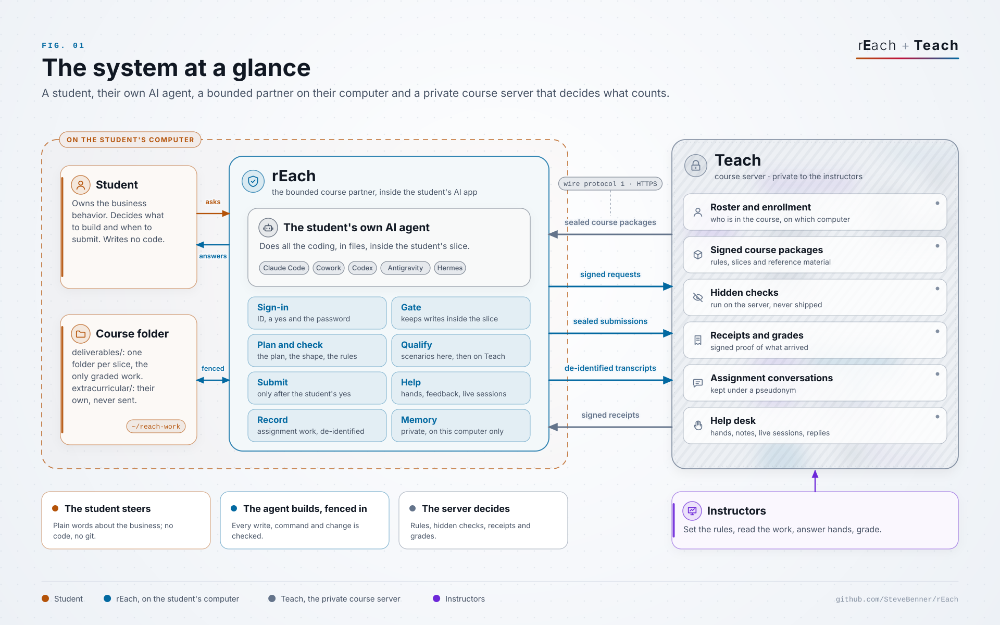
</picture>

The student owns the business behavior and writes no code. The agent does all the coding, in files, inside the student's slice. rEach signs the student in, gates, plans and checks, qualifies, submits on the student's yes, carries help requests, records signed-in assignment work de-identified and keeps a private memory. Teach holds the roster, signs the course packages, runs the hidden checks, signs the receipts, keeps assignment conversations under a pseudonym and carries hands, notes and live sessions to the instructors.

4K PNG: [light](https://github.com/SteveBenner/rEach/releases/download/figures-2/01-system-at-a-glance-light.png) · [dark](https://github.com/SteveBenner/rEach/releases/download/figures-2/01-system-at-a-glance-dark.png)

## 2. Trust boundaries

<picture>
  <source media="(prefers-color-scheme: dark)" srcset="assets/figures/02-trust-boundaries-dark.svg">
  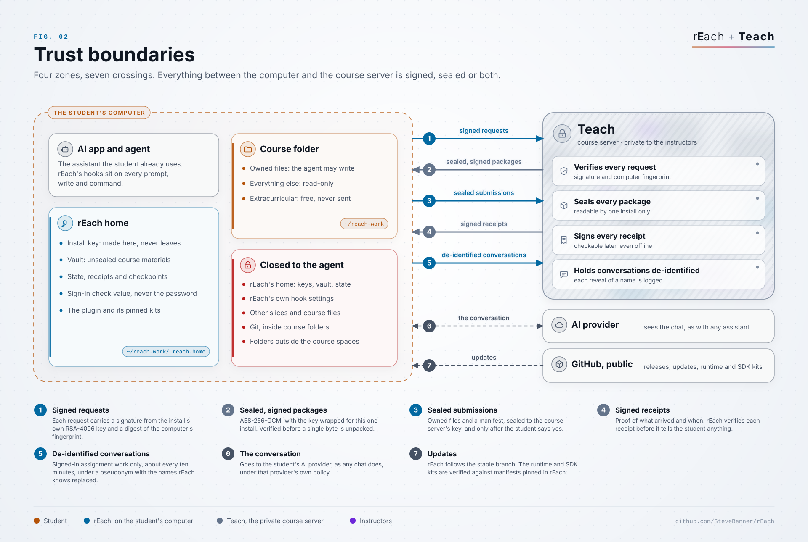
</picture>

Everything between the computer and the course server is signed, sealed or both (`specs/wire.yml`: request signatures, sealed envelopes, signed receipts). Signed-in assignment conversations leave about every ten minutes under a pseudonym (`PRIVACY.md`). The conversation goes to the student's AI provider as any chat does. rEach follows the `stable` branch, and its runtime and SDK kits are verified against manifests pinned in rEach. rEach's home, `~/reach-work/.reach-home`, is closed to the agent.

4K PNG: [light](https://github.com/SteveBenner/rEach/releases/download/figures-2/02-trust-boundaries-light.png) · [dark](https://github.com/SteveBenner/rEach/releases/download/figures-2/02-trust-boundaries-dark.png)

## 3. Validation, enrollment and sign-in

<picture>
  <source media="(prefers-color-scheme: dark)" srcset="assets/figures/03-enrollment-handshake-dark.svg">
  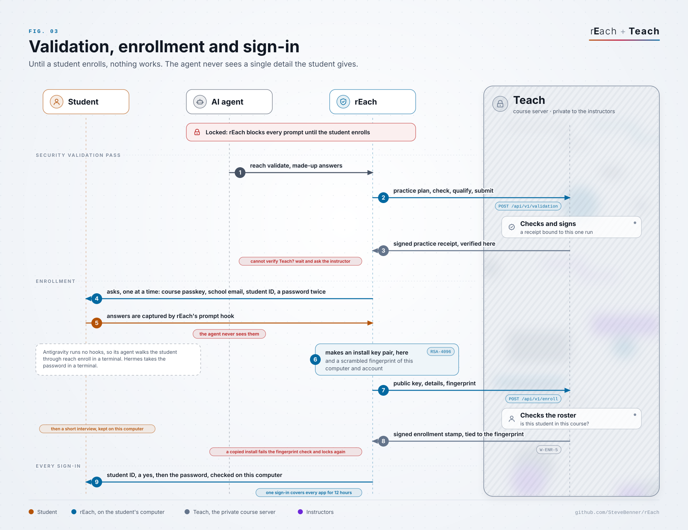
</picture>

Until a student enrolls, rEach blocks every prompt. First the agent runs a security validation pass with made-up practice answers and rEach verifies Teach's signed practice receipt (`specs/security-validation.yml`); if it cannot, the student is told to wait and contact the instructor. Then rEach asks for the course passkey, school email, student ID and a password itself, through its prompt hook, so the agent never sees them. It makes the install key pair and a scrambled fingerprint on the computer; Teach checks the roster and answers with a signed stamp tied to that fingerprint (W-ENR-1..9). A copied install fails the fingerprint check and locks again. Every later sign-in asks for the student ID, a yes and the password, checked on the computer, and covers every app for 12 hours (W-ID-1, W-ID-5). Antigravity runs no hooks, so it enrolls in a terminal; Hermes takes the password in a terminal.

4K PNG: [light](https://github.com/SteveBenner/rEach/releases/download/figures-2/03-enrollment-handshake-light.png) · [dark](https://github.com/SteveBenner/rEach/releases/download/figures-2/03-enrollment-handshake-dark.png)

## 4. The work lifecycle

<picture>
  <source media="(prefers-color-scheme: dark)" srcset="assets/figures/04-work-lifecycle-dark.svg">
  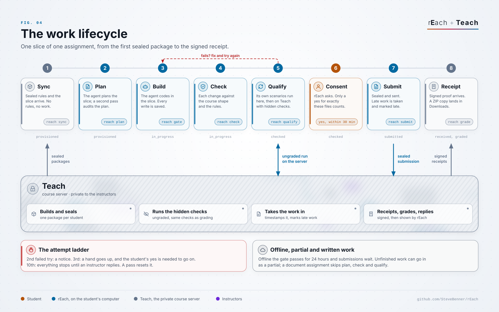
</picture>

Sync, plan, build, check, qualify, consent, submit, receipt. The state names under each stage are the `slice_workspace` states in `reach.spec.yml`. Qualification runs the plan audit, the scored passes and the agent's own scenarios here and then on Teach with the hidden checks. On the attempt ladder the second failed try brings a notice, the third raises a hand and needs the student's yes to go on, and the tenth stops until an instructor replies. Late work is accepted and marked late; offline, the gate passes for up to 24 hours on verified rules and submissions queue. A document assignment hands in written files and skips plan, check and qualify.

4K PNG: [light](https://github.com/SteveBenner/rEach/releases/download/figures-2/04-work-lifecycle-light.png) · [dark](https://github.com/SteveBenner/rEach/releases/download/figures-2/04-work-lifecycle-dark.png)

## 5. Guardrail layers

<picture>
  <source media="(prefers-color-scheme: dark)" srcset="assets/figures/05-guardrail-layers-dark.svg">
  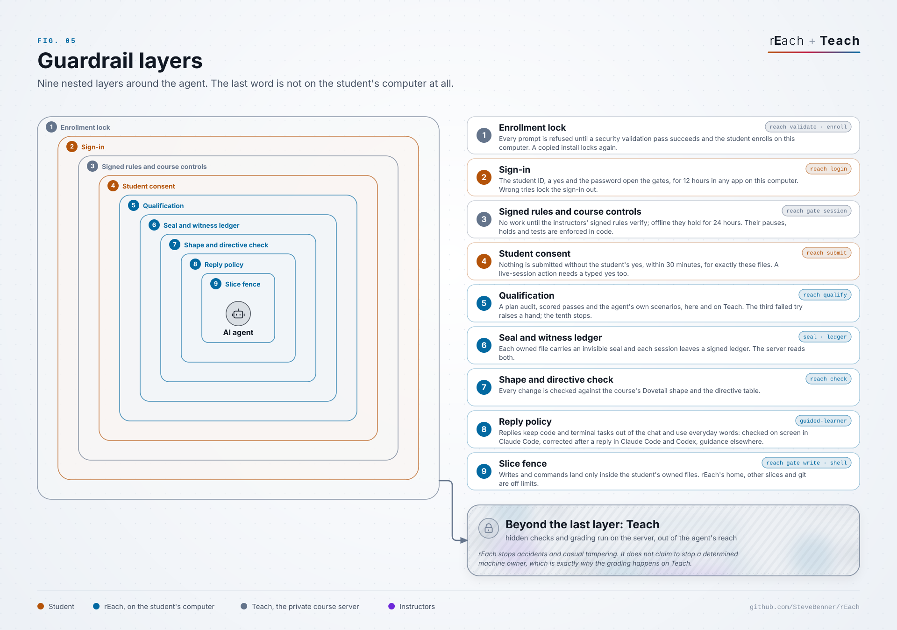
</picture>

Enrollment lock, sign-in, signed rules and course controls, student consent, qualification, seal and witness ledger, shape and directive check, reply policy and slice fence, each with the command or policy that enforces it. The reply policy is the `guided-learner` package: checked on screen in Claude Code, corrected after a reply in Claude Code and Codex, guidance in other apps. rEach's protections stop accidents and casual tampering; they are not a guarantee against a determined machine owner, which is why grading happens on Teach (`reach.spec.yml`, `security.honesty`).

4K PNG: [light](https://github.com/SteveBenner/rEach/releases/download/figures-2/05-guardrail-layers-light.png) · [dark](https://github.com/SteveBenner/rEach/releases/download/figures-2/05-guardrail-layers-dark.png)

## 6. Who may do what

<picture>
  <source media="(prefers-color-scheme: dark)" srcset="assets/figures/06-permissions-dark.svg">
  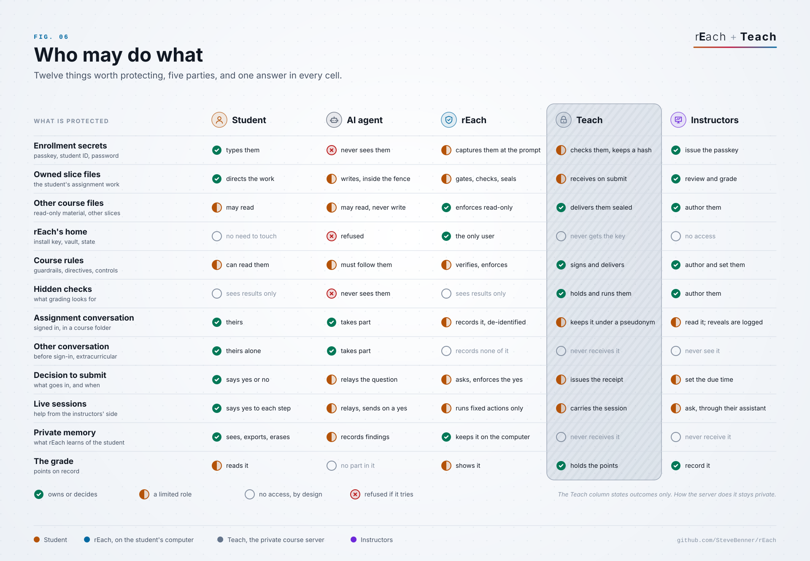
</picture>

Each cell says whether a party owns or decides, has a limited role, has no access by design, or is refused if it tries. The Teach column states outcomes only.

4K PNG: [light](https://github.com/SteveBenner/rEach/releases/download/figures-2/06-permissions-light.png) · [dark](https://github.com/SteveBenner/rEach/releases/download/figures-2/06-permissions-dark.png)

## 7. The privacy map

<picture>
  <source media="(prefers-color-scheme: dark)" srcset="assets/figures/07-privacy-map-dark.svg">
  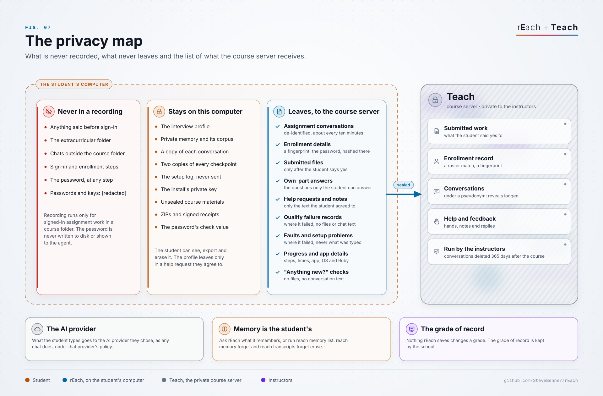
</picture>

The picture of [`PRIVACY.md`](../PRIVACY.md). Signed-in assignment work in a course folder is recorded and sent to Teach de-identified; nothing else said is, and the password never is. The profile, the private memory, a copy of each conversation, the checkpoints, the setup log and the install key stay on the computer. Teach receives enrollment details, submitted work after a yes, own-part answers, agreed help requests and notes, qualify failure records, fault reports, progress and app details, and "anything new?" checks.

4K PNG: [light](https://github.com/SteveBenner/rEach/releases/download/figures-2/07-privacy-map-light.png) · [dark](https://github.com/SteveBenner/rEach/releases/download/figures-2/07-privacy-map-dark.png)

## 8. Deployment topology

<picture>
  <source media="(prefers-color-scheme: dark)" srcset="assets/figures/08-deployment-topology-dark.svg">
  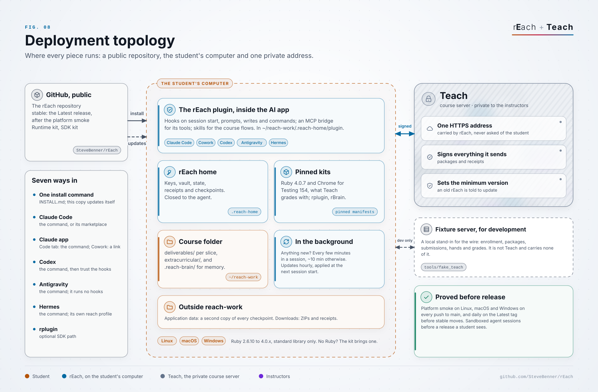
</picture>

rEach installs from this repository into Claude Code, the Claude app, Codex, Antigravity or Hermes on Linux, macOS or Windows. The copy the install command makes updates itself from the `stable` branch. `tools/fake_teach` is a local stand-in for development and is not Teach. [`deploy-and-test.md`](deploy-and-test.md) walks through it.

4K PNG: [light](https://github.com/SteveBenner/rEach/releases/download/figures-2/08-deployment-topology-light.png) · [dark](https://github.com/SteveBenner/rEach/releases/download/figures-2/08-deployment-topology-dark.png)

## 9. Why the two belong together

<picture>
  <source media="(prefers-color-scheme: dark)" srcset="assets/figures/09-why-together-dark.svg">
  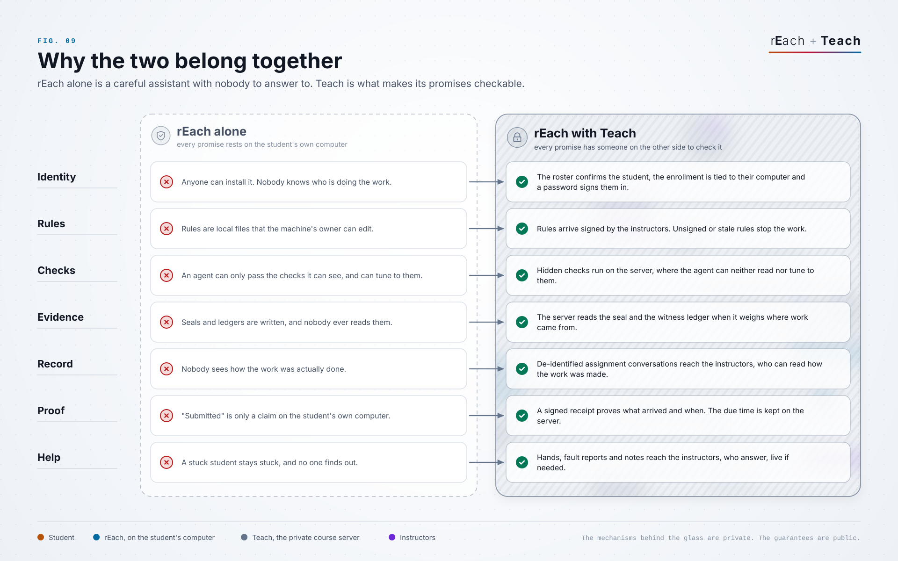
</picture>

Alone, every promise rEach makes rests on the student's own computer. With Teach, each one has someone on the other side to check it: a roster, signed rules, hidden checks, a reader for the seal and ledger, instructors who read the assignment conversations, signed receipts and instructors who answer.

4K PNG: [light](https://github.com/SteveBenner/rEach/releases/download/figures-2/09-why-together-light.png) · [dark](https://github.com/SteveBenner/rEach/releases/download/figures-2/09-why-together-dark.png)

## 10. The whole system on one sheet

<picture>
  <source media="(prefers-color-scheme: dark)" srcset="assets/figures/10-system-poster-dark.svg">
  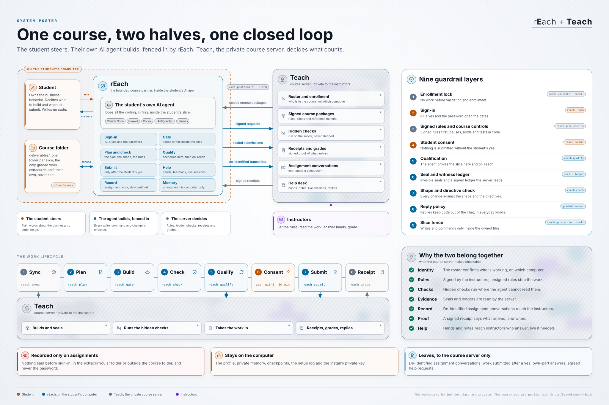
</picture>

For slides and print. The 4K PNG is the one to project.

4K PNG: [light](https://github.com/SteveBenner/rEach/releases/download/figures-2/10-system-poster-light.png) · [dark](https://github.com/SteveBenner/rEach/releases/download/figures-2/10-system-poster-dark.png)

## 11. Reaching the instructors

<picture>
  <source media="(prefers-color-scheme: dark)" srcset="assets/figures/11-reaching-the-instructors-dark.svg">
  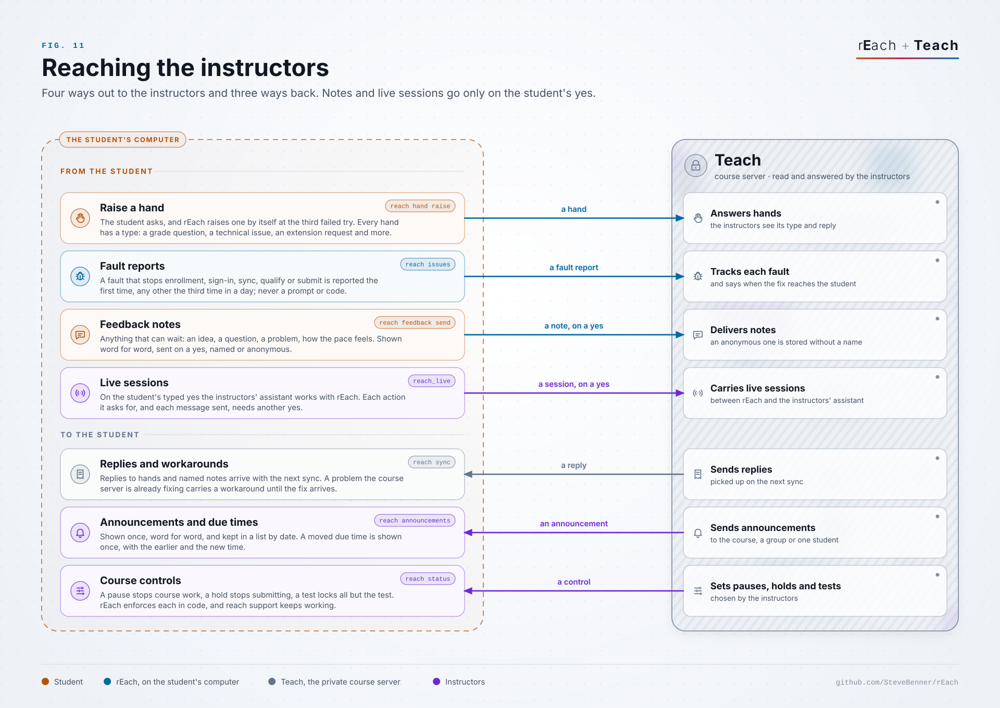
</picture>

A hand carries a type and is raised by the student or by rEach at the third failed try. Fault reports go by themselves, without a prompt or code. Feedback notes and live-session steps wait for the student's yes, and a note can be anonymous. Replies, workarounds, announcements, due-time changes and the instructors' pauses, holds and tests come back with the next sync.

4K PNG: [light](https://github.com/SteveBenner/rEach/releases/download/figures-2/11-reaching-the-instructors-light.png) · [dark](https://github.com/SteveBenner/rEach/releases/download/figures-2/11-reaching-the-instructors-dark.png)

## 12. What rEach keeps on the computer

<picture>
  <source media="(prefers-color-scheme: dark)" srcset="assets/figures/12-what-stays-on-the-computer-dark.svg">
  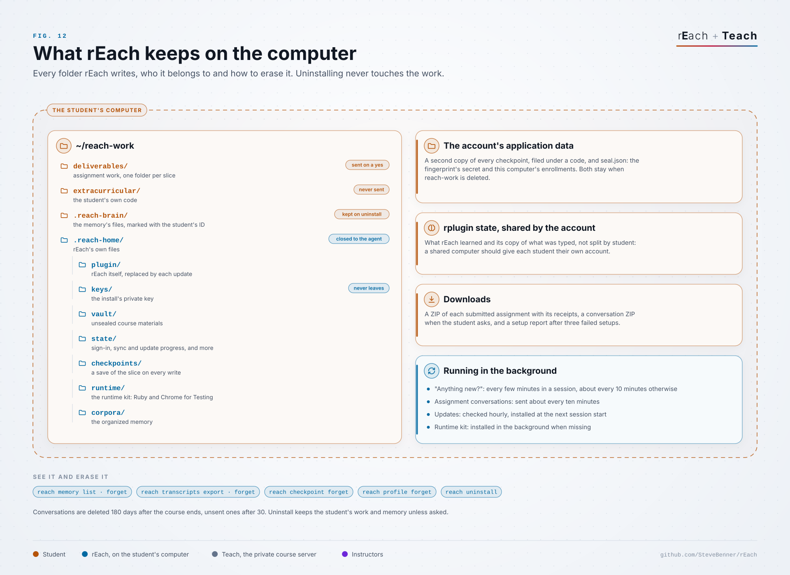
</picture>

`~/reach-work` holds the student's work, the memory in `.reach-brain` and rEach's own closed home in `.reach-home`. A second copy of every checkpoint and `seal.json` live in the account's application data, what rEach learned is in the rplugin state folder shared by the computer account, and ZIPs and receipts go to Downloads. `PRIVACY.md` lists every copy and how long it is kept.

4K PNG: [light](https://github.com/SteveBenner/rEach/releases/download/figures-2/12-what-stays-on-the-computer-light.png) · [dark](https://github.com/SteveBenner/rEach/releases/download/figures-2/12-what-stays-on-the-computer-dark.png)
